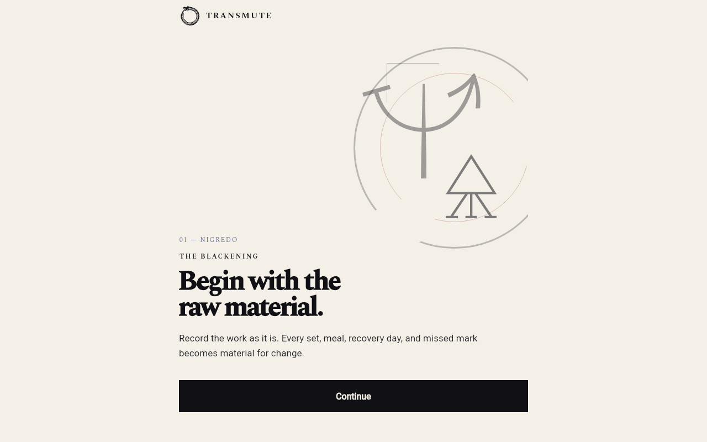
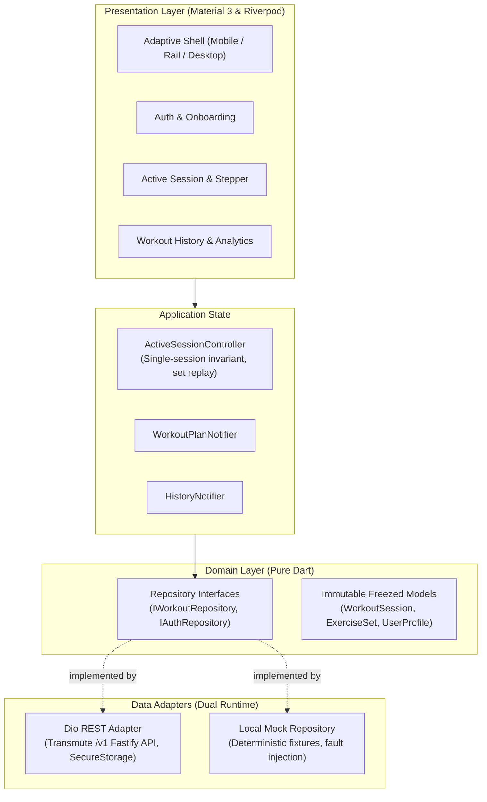

# Transmute Flutter

> Cross-platform, offline-first strength training application built with Flutter, Riverpod, and Clean Architecture.

[](https://transmute.mzootfb.xyz)
[](https://flutter.dev)
[](#verification)
[](LICENSE)

Transmute Flutter is a production-grade client engineered around Transmute's core training-record loop: authentication, structured workout plan selection, strict single active session tracking with idempotent set logging, real-time rest timer orchestration, and immutable completed workout history.

It shares backend services and domain models with the sibling Expo application ([`transmute`](https://github.com/jsalg-byte/transmute)), serving as a reference implementation of Flutter Clean Architecture, responsive Material 3 layout, and strict client-side state invariants.

---

## Visual Demonstration

| Desktop Experience (1280px) | Mobile Experience (390px) |
| :---: | :---: |
|  |  |
| *Adaptive desktop layout with navigation rail and high-density tracking* | *Touch-first responsive mobile interface with bottom navigation* |

---

## Relationship to the Expo Client

Transmute originated as a React Native / Expo application supported by a Fastify and PostgreSQL backend. This Flutter application was developed to explore and demonstrate:

1. **Deterministic State Modeling**: Utilizing Riverpod and Freezed to enforce strict UI states (loading, optimistic mutations, offline reconciliation, and error boundaries) without runtime surprises.
2. **First-Class Multi-Platform Delivery**: Compiling from a unified codebase to Web, macOS desktop, iOS, and Android with responsive breakpoint shells (bottom navigation `<600dp`, navigation rail `600–1023dp`, and wide header navigation `≥1024dp`).
3. **Dual Execution Modes**: Seamlessly switching between a live networked REST client and a zero-dependency local mock engine for rapid testing and demonstrations.

---

## Architectural Overview

The repository strictly isolates domain logic, data persistence, network transport, and reactive UI:



### Key Subsystems

- **Single Active Session Invariant**: Guarded by `ActiveSessionController`. Prevents concurrent sessions across devices, persists absolute UTC rest deadlines, and invalidates cached history upon completion.
- **Idempotent Set Replay**: Unacknowledged workout sets are stored in protected local storage with client-generated UUID operation IDs. The client replays pending sets upon network reconnection and blocks session finalization until all entries are acknowledged by the server.
- **Prescription Modes**: Supports both standard repetition-based sets (`reps`, `weightKg`) and timed exercises (`targetDurationSeconds`, `loggedDurationSeconds`).

---

## Execution Modes

### 1. Zero-Dependency Mock Mode (Recommended for Evaluation)

Mock mode runs entirely in the browser or emulator with no external backend or database setup required. It mounts an isolated fixture dataset and includes interactive fault-injection flags.

```sh
.fvm/flutter_sdk/bin/flutter run -d chrome \
  --dart-define=TRANSMUTE_REPOSITORY_MODE=mock
```

> **Tip:** Inject a simulated network fault on the first set by appending:
> `--dart-define=TRANSMUTE_MOCK_FAIL_FIRST_SET=true`

### 2. Live API Mode

Connects to the canonical Fastify API server (`https://api.transmute.mzootfb.xyz`) or a local instance. Stores bearer tokens in encrypted storage (`flutter_secure_storage`).

```sh
.fvm/flutter_sdk/bin/flutter run -d web-server \
  --web-hostname=localhost \
  --web-port=8081 \
  --dart-define=TRANSMUTE_REPOSITORY_MODE=api \
  --dart-define=TRANSMUTE_API_BASE_URL=https://api.transmute.mzootfb.xyz
```

*Note: Use `http://localhost:8081` to satisfy backend CORS policies.*

---

## Verification & Quality Assurance

The test suite exercises unit domain rules, Riverpod state transitions, and widget rendering across mobile and desktop breakpoints:

```sh
# Static analysis
.fvm/flutter_sdk/bin/flutter analyze

# Comprehensive unit, provider, and widget tests (145 tests)
.fvm/flutter_sdk/bin/flutter test

# Production web build
.fvm/flutter_sdk/bin/flutter build web
```

---

## Deployment

Production deployments are containerized using Docker and Nginx, serving the pre-rendered release bundle from `release/web` with client-side GoRouter SPA rewrites.

- **Live URL**: [https://transmute.mzootfb.xyz](https://transmute.mzootfb.xyz)
- **Deployment Guide**: See [`docs/DEPLOYMENT.md`](docs/DEPLOYMENT.md) for Coolify configurations and environment definitions.
- **Developer Guidelines**: Detailed contributor rules and architectural boundaries are documented in [`AGENTS.md`](AGENTS.md) and [`docs/ARCHITECTURE.md`](docs/ARCHITECTURE.md).

---

## License

This project is licensed under the MIT License. See [LICENSE](LICENSE) for details.
